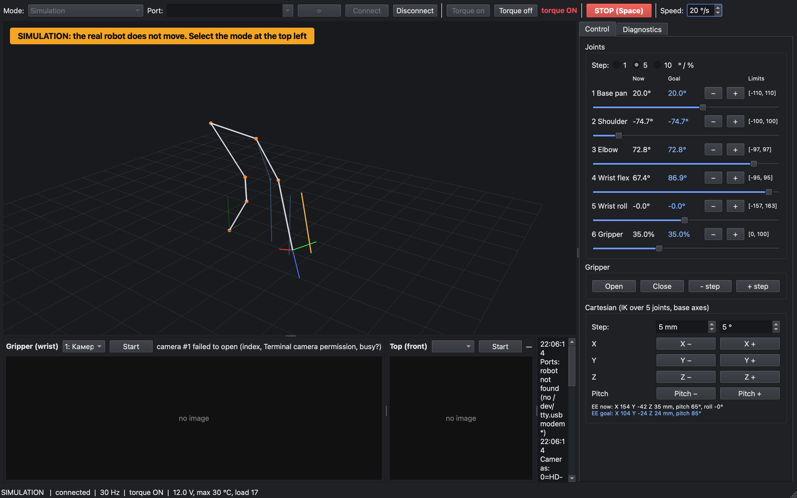
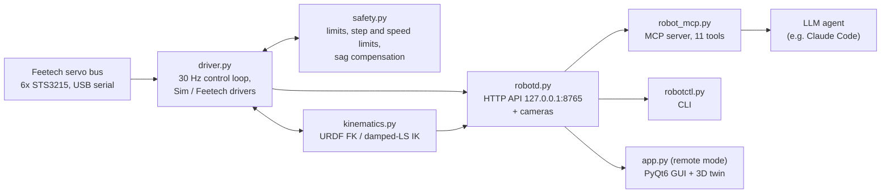

# so101-control

[](https://github.com/Danykrane/so101-control/actions/workflows/ci.yml)
[](LICENSE)

A safety-first control stack for the **SO-101** 6-DoF robot arm (Feetech STS3215 servos):
a read-only-on-connect servo driver, URDF forward/inverse kinematics, a safety filter, a robot daemon
with an HTTP API, an **MCP server that lets an LLM agent drive the real arm**, and a PyQt6 GUI with a 3D digital twin.

It runs fully in simulation without hardware, and it has been used on a physical SO-101 follower arm.



## Why

Off-the-shelf scripts for hobby arms tend to write to the motors on startup, re-run calibration, or jump to
a target as soon as torque is enabled. This project treats the arm as real hardware next to a person:
connecting only reads, nothing moves until an explicit command, and every command from every client
(GUI, CLI, LLM agent) passes through the same safety filter.

## Architecture



One process (`robotd`) owns the serial port and the cameras. The GUI, the CLI and the agent are clients,
so a human can watch the 3D twin and hit STOP while the agent is moving the arm.

| Module | Responsibility |
|---|---|
| `driver.py` | `RobotState`, `SimDriver` (first-order servo model), `FeetechDriver` (LeRobot `SerialMotorsBus`); 30 Hz loop in a worker thread, command queue, watchdog, telemetry |
| `safety.py` | Pure numpy safety filter: limit clipping, per-tick step limit, synchronous speed governor, lead limit, anti-sag I-loop |
| `kinematics.py` | URDF parser, FK, 5-DoF IK (damped least squares with adaptive Levenberg-Marquardt damping), Cartesian path planner, motor-to-URDF joint map |
| `robotd.py` | Robot daemon: HTTP JSON API, motion commands with "arrived / stalled / preempted" results, rest pose, camera snapshots |
| `robot_mcp.py` | MCP server (FastMCP) exposing robotd to an LLM agent |
| `robotctl.py` | Command-line client |
| `remote.py` | `RemoteDriver`: the GUI as a robotd client with the same API as a local driver |
| `app.py` | PyQt6 GUI: 3D skeleton with goal "ghost", joint and Cartesian jog, gripper, two cameras, motor diagnostics, log |
| `cameras.py` | macOS camera enumeration and threaded OpenCV capture |
| `ping_robot.py` | Read-only hardware check: ping 6 motors, read calibration and telemetry |

Only `app.py` imports Qt; everything else is UI-agnostic and is meant to be ported to C++.

## Features

**Safety**
- Connecting is read-only: ping, calibration from EEPROM, positions, torque, voltage, temperature.
  LeRobot `calibrate()`, `configure()` and `write_calibration()` are never called, so PID gains, limits and
  calibration in EEPROM stay untouched.
- Torque is enabled only by an explicit command: `Goal_Position = Present_Position` (acknowledged by each motor),
  then `Torque_Enable`. The arm freezes in place instead of jumping.
- Goals are clipped to the intersection of URDF and calibration limits. A joint already outside its limit may only
  move back inside, never snap to the boundary.
- Synchronous speed governor: arm joints arrive together on a straight joint-space path, at most 2 deg per tick;
  the commanded goal never leads the measured position by more than 10 deg.
- Torque is re-read at about 3 Hz: if a servo drops torque (overheat, overload) control stops.
  About 1 s without a link: the driver disconnects without touching torque.
- Cartesian goals below a configurable table height are rejected; IK steps that need a joint jump over 15 deg
  (near the straight-elbow singularity) are refused with a reason.

**Kinematics and control**
- FK/IK straight from the URDF, 5-DoF task space (x, y, z, pitch, roll); Cartesian moves are split into sub-steps
  and IK is chained from the current pose to stay on the same solution branch.
- Outer integral loop against gravity sag: the servo P controller falls 1-2 deg short under the arm weight
  (up to 10 mm at the tool); a bounded offset (at most 3 deg) is added only for settled joints inside an error window.

**Agent and tooling**
- `robotd` reports why a motion ended: arrived, stalled against an obstacle, timed out, or preempted by another client
  (for example a human pressing STOP in the GUI).
- MCP tools: `robot_state`, `robot_torque`, `robot_move_joints`, `robot_move_cartesian`, `robot_move_to_pose`,
  `robot_gripper`, `robot_go_rest`, `robot_stop`, `robot_camera`, `robot_set_speed`, `robot_log`.
  The wrist camera snapshot is returned as an image, so the agent can look before the next step.
- Joint signs and zeros were verified on hardware: shoulder, elbow and wrist against the resting pose,
  base pan and wrist roll by the shift and rotation of the wrist-camera image.

## Quick start (simulation, no hardware)

```bash
python -m venv .venv
.venv/bin/pip install -r requirements.txt
.venv/bin/python app.py --sim
```

Robot daemon in simulation, driven from the CLI:

```bash
.venv/bin/python robotd.py --sim --cameras ""
.venv/bin/python robotctl.py torque on
.venv/bin/python robotctl.py cart --dz 20
.venv/bin/python robotctl.py state
```

## Real hardware

Tested on macOS with an SO-101 follower arm, Python 3.12 and LeRobot 0.6.2 (its `SerialMotorsBus` on top of `rustypot`).

1. Install LeRobot with serial motor support into the same environment
   (see the [LeRobot installation guide](https://github.com/huggingface/lerobot)),
   for example `pip install "lerobot[serial-motors]"`.
2. Check the arm without moving it: `python ping_robot.py`.
3. Start the daemon from Terminal (macOS grants camera access to the parent app): `./robotd.command`.
4. Connect the GUI to it: `./run.command --robotd`, or use `robotctl.py`.

Calibration is read from the servo EEPROM; the arm is expected to be calibrated once with LeRobot.
Joint sign and zero offsets live in `config/joint_map.json`.

### Connecting an LLM agent (MCP)

Copy `.mcp.json.example` to `.mcp.json` in your agent's project, fix the path to `robot_mcp.py`
and start `robotd` first. The MCP server only forwards requests to `robotd` and needs `uv` (or `pip install "mcp>=1.10,<2"`).

## Tests

```bash
.venv/bin/python -m pytest
```

24 tests run without hardware and without LeRobot: FK/IK round trips, limit and singularity handling,
the speed governor, sag compensation, the simulated driver, `robotd` command semantics, and a fake Feetech bus that
asserts **connecting writes nothing** and **enabling torque writes the goal first**.
CI runs `ruff` and `pytest` on every push.

## Limitations

- Python prototype: the 30 Hz loop runs in a Python thread, not a real-time controller.
- The simulator has no gravity and no collisions; there is no self-collision check yet.
- Camera enumeration and the `.command` launchers are macOS-specific; serial port auto-detection looks for
  `/dev/tty.usbmodem*`-style names.
- The HTTP API listens on localhost only and has no authentication.
- Sag compensation is covered by tests in simulation but not yet validated on hardware.

## Roadmap

- **ROS 2**: a `ros2_control` hardware interface in C++ for the Feetech bus, with the same read-only connect and
  torque-enable rules, plus MoveIt 2 integration.
- **C++ / Qt 6 port**: kinematics and the safety filter in C++, a Qt 6 desktop app with a Qt Quick 3D digital twin and
  a task pipeline editor.
- MuJoCo digital twin with mirror (real to sim) and preview (sim to real after confirmation) modes.
- Self-collision checks with sphere models; ZeroMQ or gRPC transport instead of HTTP polling.
- LeRobot dataset recording from teleoperation and learned policies (ACT, SmolVLA) behind the same safety filter.

See [docs/ROADMAP.md](docs/ROADMAP.md) for stages and acceptance criteria.

## Credits and licenses

- This project: [MIT](LICENSE).
- [LeRobot](https://github.com/huggingface/lerobot) (Apache-2.0) by Hugging Face: used as a dependency for the
  Feetech servo bus (`lerobot.motors.SerialMotorsBus`). LeRobot code is not included in this repository.
- `urdf/so101_new_calib.urdf` comes from [TheRobotStudio/SO-ARM100](https://github.com/TheRobotStudio/SO-ARM100)
  (Apache-2.0), unmodified. See [NOTICE](NOTICE).
